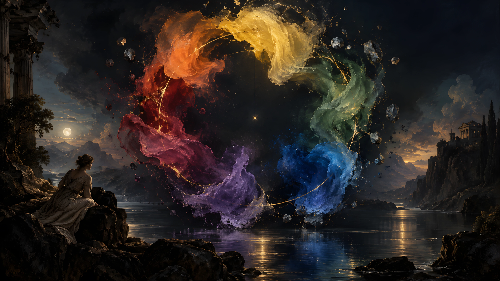
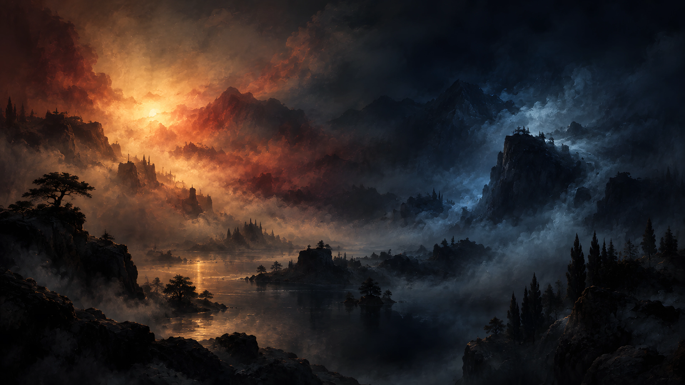
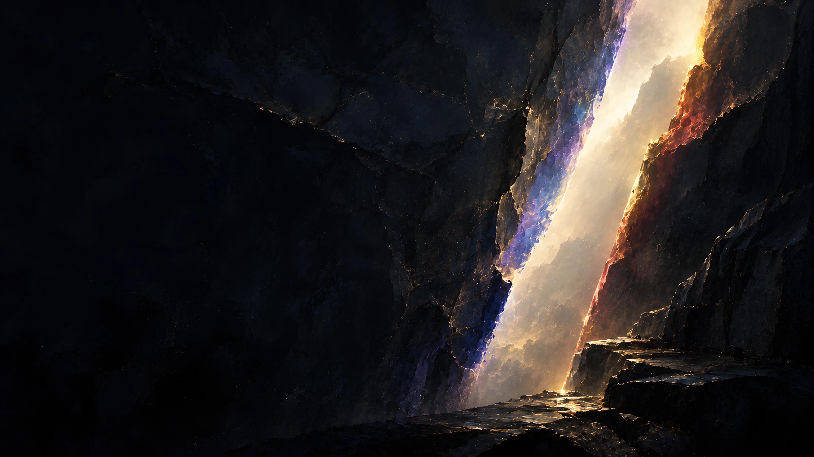
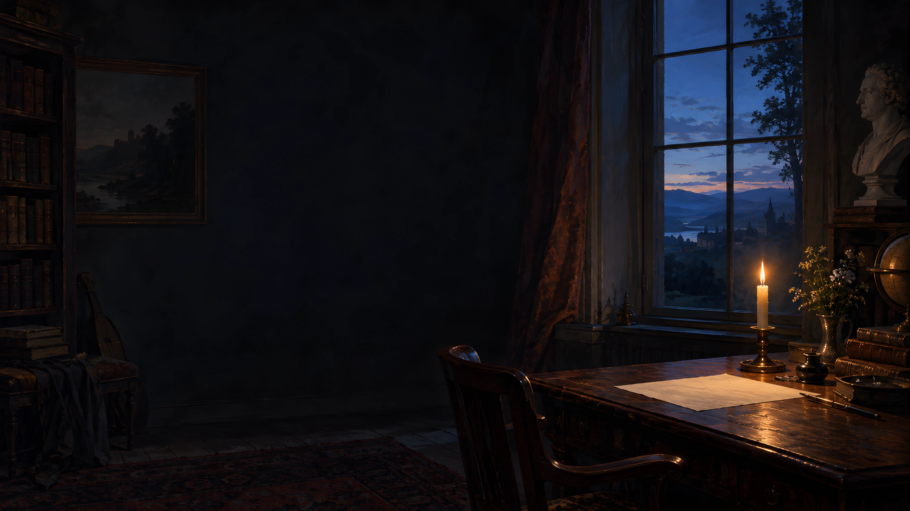
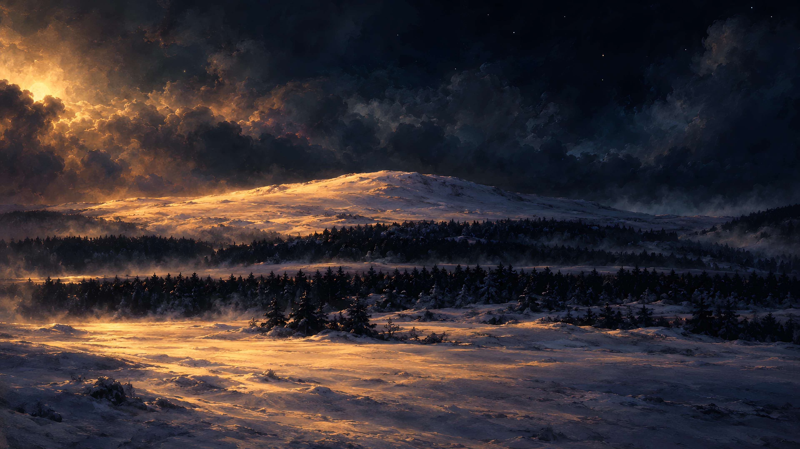
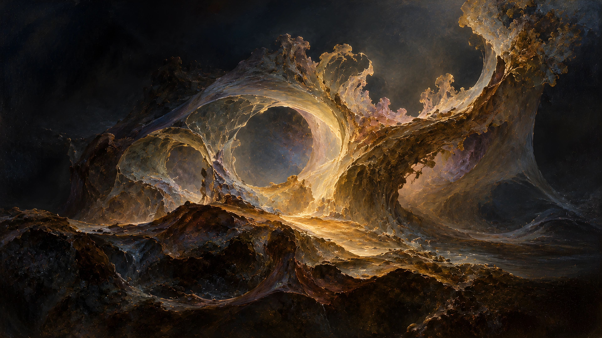

# Farbenlehre

A dark theme for [Omarchy](https://omarchy.org), inspired by Goethe's *Theory of Colours* (1810). Blue-black surfaces, warm text and a yellow accent, paired with six painterly wallpapers exploring light, darkness and color.


*A real 4K Omarchy desktop: Bash, Neovim and btop over Farbenkreis.*

## Install

From the Omarchy menu: press **Super + Space**, then **Install → Style → Theme**, and paste the repository URL when it asks:

```
https://github.com/thepixelgardener-create/omarchy-farbenlehre-theme
```

Or straight from a terminal:

```sh
omarchy theme install https://github.com/thepixelgardener-create/omarchy-farbenlehre-theme
```

Omarchy installs and activates the theme, generating application colors from `colors.toml`. Choose a wallpaper with **Super + Ctrl + Space**.

## What makes it different

**Readable signal colors.** All twelve standard and bright terminal signal colors reach at least 5:1 contrast against the theme background.

**Red and green differ in brightness as well as hue.** Green is deliberately brighter than red. The palette was checked with simulations of protanopia and deuteranopia to assess their separation.

**A palette with a shared idea.** Goethe's observations of light and darkness through haze inspire the warm text and cool ground. Yellow marks focus, violet marks selection, and the active window border moves from yellow to red. [Read the design notes](DESIGN.md) for the reasoning behind each choice.

**Native Omarchy integration.** The theme supplies its palette, icon theme and artwork. Omarchy's templates generate the terminal, editor and shell configuration.

## Wallpapers

Click a preview to open the original image.

| Farbenkreis | Trübe |
| --- | --- |
| [](backgrounds/01-farbenkreis.webp) | [](backgrounds/02-truebe.webp) |
| Six pigment veils circling over moonlit water, watched from the ruins. | Warm light and cool darkness emerging through atmospheric haze. |

| Kanten | Dämmerung |
| --- | --- |
| [](backgrounds/03-kanten.webp) | [](backgrounds/04-daemmerung.webp) |
| Warm and cool fringes where light meets dark stone. | Goethe’s study at dusk, where warm candlelight meets the last blue twilight. It comes with an [intro](backgrounds/intros/04-daemmerung.mp4): the flame flickers and the room breathes with its light, then settles back into the still. |

| Winterzug | Das Werdende |
| --- | --- |
| [](backgrounds/05-winterzug.webp) | [](backgrounds/06-werdende.webp) |
| The Brocken on a winter night, after Goethe's own sketch from his Harz journey of 1777: moonlight turns the snow gold and its shadows lilac. | Becoming: a form that is neither plant, mineral nor architecture grows out of the dark, lit amber and gold at its edges, lavender in its depths. |

### Resolution and displays

All six wallpapers are **3840 × 2160**, upscaled from the generator's 1672 × 941 originals, so they are sharp on a 4K display. Ultrawide, 16:10 and portrait screens crop the composition differently.

Dämmerung also has a 7-second intro, `intros/04-daemmerung.mp4`, which plays once in the way of the built-in themes' intros: when you log in or switch to Farbenlehre with Dämmerung as the wallpaper. It starts and ends on the still, so the desktop simply comes to rest on it. Turn intros off with `omarchy theme bg intro disable`. [ASSETS.md](ASSETS.md) records dimensions and provenance.

## Palette checks

The design notes record 38 checks covering palette contrast, simulated red–green separation, and wallpaper overlay contrast at modeled lock-screen and launcher opacity values.

| Measurement | Recorded result |
| --- | --- |
| Main text on the background | 14.8:1 |
| Weakest terminal signal color | 5.03:1 |
| Selected text | 12.6:1 |
| Muted text on the background | 4.04:1 |

[DESIGN.md](DESIGN.md) documents the targets, assumptions and known trade-offs. The overlay measurements use conservative black and white bounds; they do not assess wallpaper composition or cropping.

## Credits and license

The ideas come from Goethe's *Zur Farbenlehre* (1810), a public-domain work. The six wallpapers are AI-generated. [ASSETS.md](ASSETS.md) records their provenance, and [GENERATION.md](GENERATION.md) preserves their prompts. The palette and written notes are original work.

Released under the [MIT license](LICENSE).
